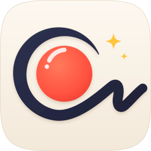
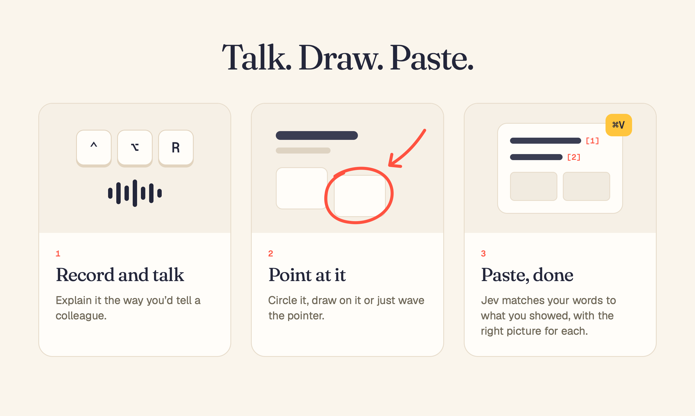

<p align="center"></p>

<h1 align="center">YapSketch</h1>

<p align="center"></p>

Stop typing paragraphs to explain one bug. Record your screen, say what's wrong and point at it. When you stop, Jev works out which of your words go with what you showed and picks the clearest picture for each point. Your words, numbered, with those pictures, are on your clipboard:

```
As you can see here these are not centered properly [1] and this one should match it [2]

~/Movies/YapSketch/2026-10-17_05-40-16/shots/1.jpg
~/Movies/YapSketch/2026-10-17_05-40-16/shots/2.jpg

For the details, run `yapsketch show k3x9`.
```

Paste it into Claude Code, Codex, Cursor, or anything with a prompt box.

## How it works

1. **You record.** Press `⌃⌥R`. YapSketch records your screen and your voice, on your Mac.
2. **You talk and point.** Say what you mean, the way you'd tell a colleague. Circle it, draw on it or just wave the pointer at it.
3. **Jev lines it up.** Your speech becomes text. Jev divides it into points, works out what you showed for each (a circle and an arrow at one button are one point), and picks the clearest moment for its picture, or a strip of frames when it's about something moving.
4. **You paste.** Your words with [1], [2] and a picture for each are on your clipboard.

## Or just yap

Hold `fn`, speak, let go. Your words land wherever you're typing, turned into text on your Mac, with fillers like "um" tidied away.

## Shortcuts

| | |
|---|---|
| `⌃⌥R` | Start or stop recording |
| `⌃⌥D`, or hold `⌃⌥` and drag | Draw on your screen |
| `⌃⌥X` | Clear drawings |
| `fn` (🌐) | Dictate (hold to talk, or tap to start and stop) |

All changeable in Settings.

## For your agent

The paste is the short version. The `yapsketch` command, installed with the app, gives your agent the rest: when you said each thing, what you drew and on which page, the full video and the transcript.

| | |
|---|---|
| `yapsketch latest` | the newest recording |
| `yapsketch show k3x9` | its full report, moment by moment |
| `yapsketch list` | recent recordings and their ids |
| `yapsketch frames k3x9 2` | frames around [2] (or a moment, `01:23`) in one picture, to look closer |
| `yapsketch path k3x9` | the folder: video, transcript, every event |

## Local or cloud, your call

Speech is turned into text on your Mac by default. Prefer a cloud model? Connect a provider in Settings › Models:

- **Opper** or **OpenRouter** (sign in): Jev, cloud speech models, and AI tidy-up for dictation.
- **TypeSafe** (your key): Jev.

Recordings stay in `~/Movies/YapSketch`. Words and pictures only leave your Mac if you turn on Jev or a cloud speech model, and then only to the provider you picked.

## Build

```sh
./scripts/build-app.sh   # → build/YapSketch.app (Xcode tools, Rust, CMake)
```

macOS 15+. Needs Screen Recording, Microphone, Accessibility and Input Monitoring.

## Credits

- [Jev](https://typesafe.ai) by TypeSafe matches what you said to what you showed and picks the pictures.
- [transcribe.cpp](https://github.com/handy-computer/transcribe.cpp) runs speech recognition on your Mac (Parakeet and Whisper models).
- [Handy](https://github.com/cjpais/Handy) inspired the dictation.
- [perfect-freehand](https://github.com/steveruizok/perfect-freehand) by Steve Ruiz draws the ink (ported to Swift, MIT).
- [Opper](https://opper.ai) and [OpenRouter](https://openrouter.ai) provide cloud models.

## License

[Apache 2.0](LICENSE). Copyright 2026 Farouq Aldori.
