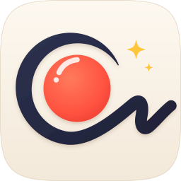
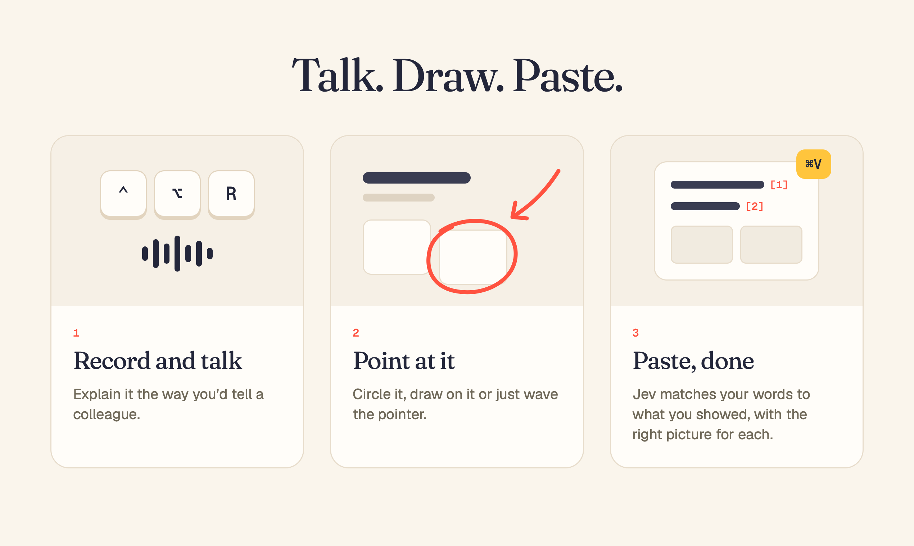

<p align="center"></p>

<h1 align="center">YapSketch</h1>

<p align="center"></p>

YapSketch is a macOS app for explaining something on your screen by talking and pointing. Walk through a bug, give design feedback, or show how a workflow should work. When you stop recording, YapSketch copies a timestamped timeline to your clipboard, with a screenshot wherever you drew or circled:

```
Screen recording in Google Chrome — Project dashboard, 00:16. What I said and did, with my screen wherever I drew or pointed:

00:00.4  Here's how I want the project dashboard to work.
00:04.6  This filter should apply to both charts.
00:05.2  [drew → 1.jpg]
00:06.8  Keep the selected date range when I switch tabs.
00:07.3  [drew → 2.jpg]

Pictures, numbered like the badge on each:
~/Movies/YapSketch/2026-10-20_15-07-41/shots/1.jpg
~/Movies/YapSketch/2026-10-20_15-07-41/shots/2.jpg

To see my screen at any moment: `yapsketch frames k2vg 00:05.2`, or a stretch: `yapsketch frames k2vg 00:04-00:08`.
```

Your agent works out what you meant. YapSketch just writes down what happened.

Paste it into Claude Code, Codex, Cursor, or anything with a prompt box.

## How it works

1. **You record.** Press `⌃⌥R`. YapSketch records your screen and your voice, on your Mac.
2. **You talk and point.** Say what you mean, the way you'd tell a colleague. Circle it, draw on it or just wave the pointer at it.
3. **It writes down what happened.** Your speech becomes text, phrase by phrase, with what you typed, pressed and switched to in between. Each drawing or circle gets a picture of the window at that moment, with a numbered badge beside the mark.
4. **You paste.** The timeline and the pictures are on your clipboard. A recording made soon after another links back to it.

## Or just yap

Hold `fn`, speak, let go. Your words land wherever you're typing, turned into text on your Mac, with fillers like "um" tidied away.

## Shortcuts

| | |
|---|---|
| `⌃⌥R` | Start or stop recording |
| `⌃⌥D`, or hold `⌃⌥` and drag | Draw on your screen |
| `⌃⌥X` | Clear drawings |
| `fn` (🌐) | Dictate (hold to talk, or tap to start and stop) |

All changeable in Settings.

## For your agent

The `yapsketch` command, installed with the app, lets your agent look closer: your screen at any moment, a stretch of it frame by frame, the full video and every word with its timing.

| | |
|---|---|
| `yapsketch latest` | the newest recording |
| `yapsketch show k2vg` | its report, with each picture after its line |
| `yapsketch list` | recent recordings and their ids |
| `yapsketch frames k2vg 01:23.4` | the screen at that moment, full size |
| `yapsketch frames k2vg 01:20-01:30` | frames across a stretch, two to a row with their times (`--every 0.5` to choose the spacing) |
| `yapsketch path k2vg` | the folder: video, transcript, every event |

## Local or cloud, your call

Speech is turned into text on your Mac by default. Prefer a cloud model? Connect a provider in Settings › Models:

- **Opper** or **OpenRouter** (sign in): cloud speech models.

Recordings stay in `~/Movies/YapSketch`. Your voice only leaves your Mac if you pick a cloud speech model, and then only to the provider you picked. Pictures never do, unless you paste them somewhere.

## SketchyBar

Add this to `sketchybarrc`, adjust the app path if needed, and run `sketchybar --reload`.

```sh
"/Applications/YapSketch.app/Contents/Resources/SketchyBar/yapsketch.sh"
```

The dot is gray when idle and red while recording. Pass SketchyBar item properties to style it, such as `label.color` for idle and `label.highlight_color` for recording.

## Build

```sh
./scripts/build-app.sh   # → build/YapSketch.app (Xcode tools, Rust, CMake)
```

macOS 15+. Needs Screen Recording, Microphone, Accessibility and Input Monitoring.

## Credits

- [transcribe.cpp](https://github.com/handy-computer/transcribe.cpp) runs speech recognition on your Mac (Parakeet and Whisper models).
- [Handy](https://github.com/cjpais/Handy) inspired the dictation.
- [perfect-freehand](https://github.com/steveruizok/perfect-freehand) by Steve Ruiz draws the ink (ported to Swift, MIT).
- [Opper](https://opper.ai) and [OpenRouter](https://openrouter.ai) provide cloud models.

## License

[Apache 2.0](LICENSE). Copyright 2026 Farouq Aldori.
